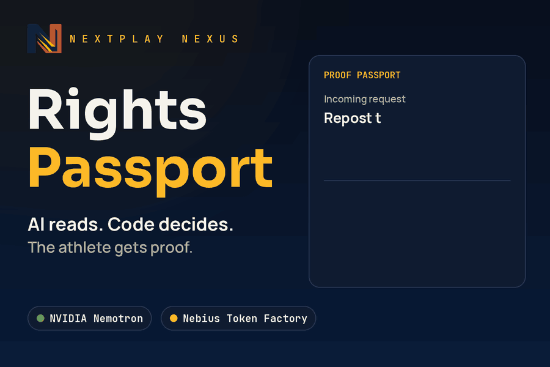
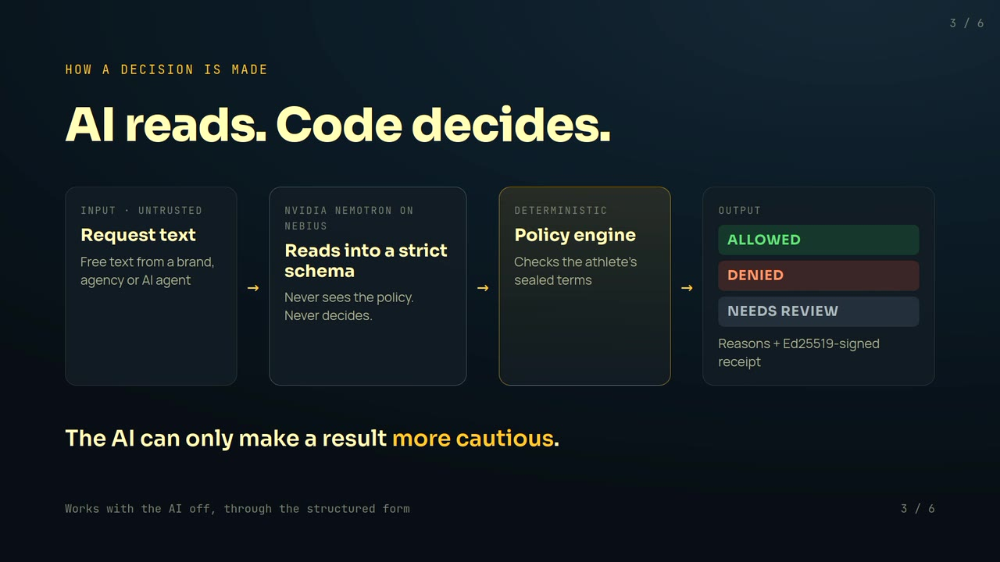
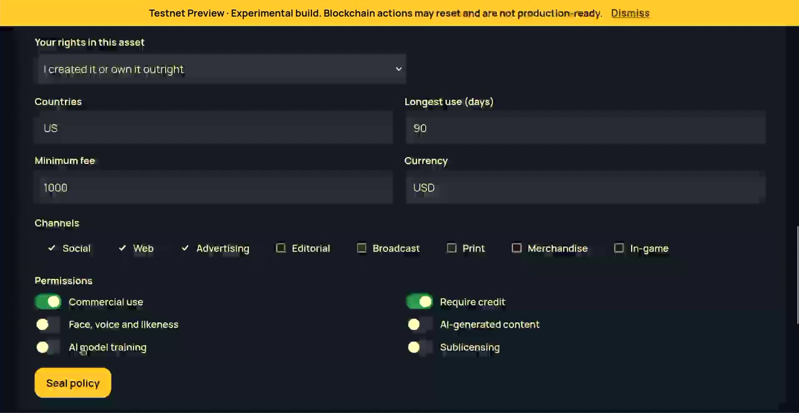
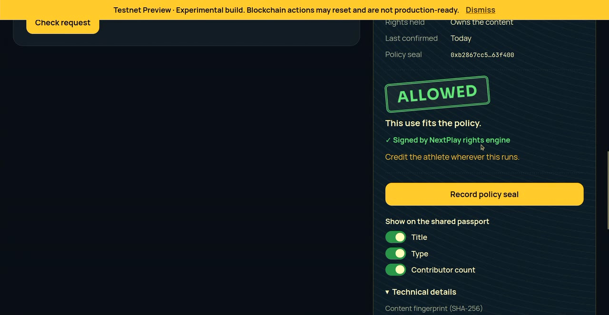
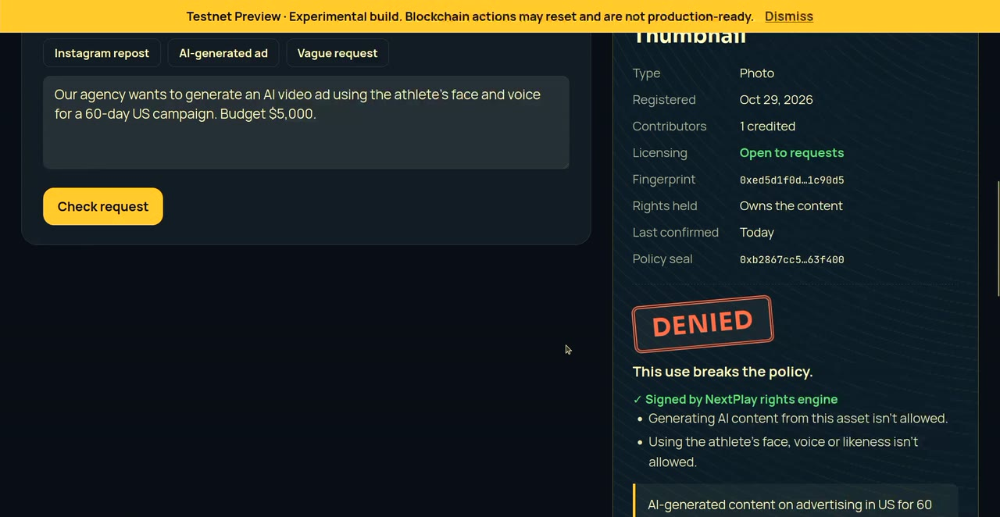
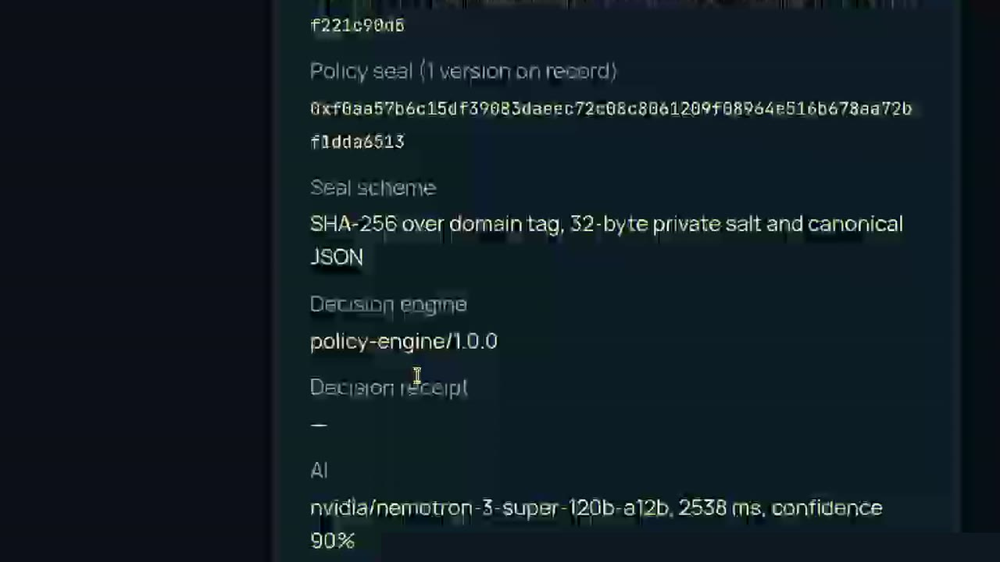
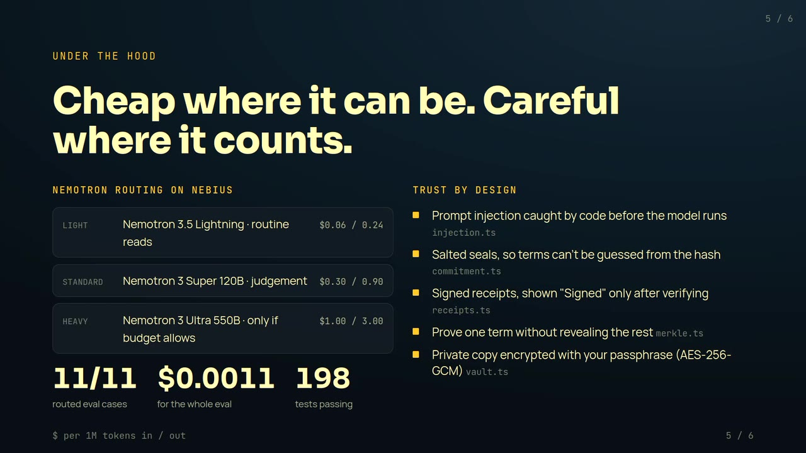
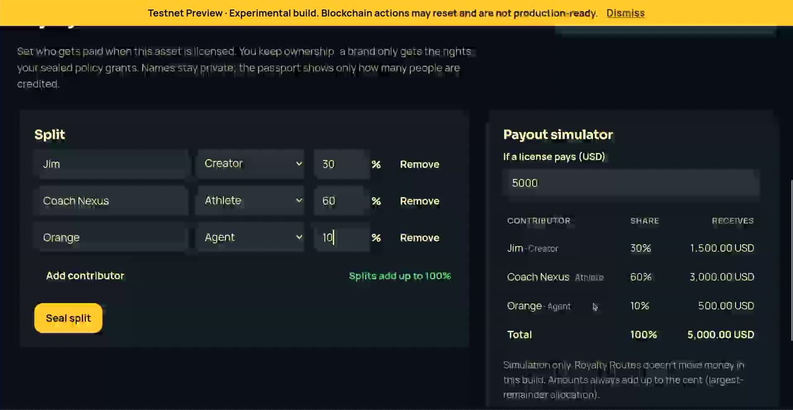

# NextPlay Rights Passport

<p align="center">
  
</p>

<p align="center">
  
  
  
  
</p>

**AI-native rights intelligence for athlete and creator content.**
A brand or AI agent asks *"can I use this asset for this purpose?"*. An NVIDIA Nemotron model on Nebius turns the messy request into structured rights data, a deterministic policy engine returns **Allowed / Denied / Needs review**, and the athlete gets a shareable Proof Passport. Private terms are committed, never published.

> ⚠️ **Experimental hackathon MVP, not audited.** This is not legal advice. It does not determine ownership or infringement, it moves no money, and in this milestone it makes no blockchain transactions.

## How a decision is made

```text
 requestText ──► Nemotron (Nebius Token Factory) ──► strict schema check ──┐
  (untrusted)     extracts + explains, never decides     (reject on fail)   │
                                                                           ▼
 rights policy ─────────────────────────────────────────► Policy Engine (deterministic)
 (versioned, salted commitment)                               │
                                                              ▼
                                          ALLOWED / DENIED / NEEDS_REVIEW + reasons
                                          AI can only make a result MORE cautious
```

| Rule | Where it is enforced |
|---|---|
| The AI never decides. It extracts, explains and flags missing info. | `apps/api/src/ai-gateway.ts`, `applyAIGate` |
| Malformed or injected model output degrades to *Needs review*. | `AIExtraction` strict schema |
| The app stays useful with the AI off. | `POST /api/v1/rights/evaluate` |
| Commitments are salted and domain-separated, so terms can't be brute-forced. | `packages/core/src/commitment.ts` |
| Canonical JSON is locale-independent, so the same policy gives the same hash everywhere. | `packages/core/src/canonical.ts` |
| Money is integer minor units and splits are basis points that sum to exactly 10000. | `schemas.ts`, `splits.ts` |
| Demo mode can never emit a transaction id. | `ledger.ts` (enforced by the type) |
| An AI-read approval only covers the terms the AI extracted, and the requester must confirm them. Text that tries to instruct the AI goes to a person. | `server.ts`, `injection.ts` |
| Decisions come with an Ed25519-signed receipt. The passport shows "Signed" only after verifying it. | `receipts.ts`, `GET /api/v1/keys` |
| The private copy of your terms is encrypted with your passphrase (PBKDF2 600k → AES-256-GCM). | `vault.ts` |
| You can prove one policy field (say, "no AI training") without revealing the rest. | `merkle.ts` |

## Screenshots

<table>
  <tr>
    <td width="50%"><br><b>AI reads. Code decides.</b> Nemotron turns the request into a strict schema; the policy engine decides.</td>
    <td width="50%"><br><b>Seal the terms.</b> Countries, channels, length, minimum fee, and switches for AI training, AI generation and likeness.</td>
  </tr>
  <tr>
    <td><br><b>Allowed</b>, after the requester confirms the terms the AI extracted. The receipt is verified before it shows "Signed".</td>
    <td><br><b>Denied</b>, with reasons: an AI ad using the athlete's face and voice breaks the policy.</td>
  </tr>
  <tr>
    <td><br><b>Every decision records the model.</b> Here: <code>nvidia/nemotron-3-super-120b-a12b</code> on Nebius Token Factory.</td>
    <td><br><b>Nemotron routing.</b> Lightning for routine reads, Super for judgement, Ultra only when the budget allows.</td>
  </tr>
  <tr>
    <td><br><b>Royalty Routes.</b> Splits must total exactly 100% before they can be sealed.</td>
    <td></td>
  </tr>
</table>

## Layout

```text
packages/core        canonicalization, commitments, schemas, policy engine, splits, ledger boundary
agent/               the rights agent's home (Unix-style): etc/ config, bin/ tools, skills/ prompts, share/ data + context
apps/api             Fastify API + agent runtime (src/agent) + Nebius/Nemotron gateway + eval runner
apps/web             Vite + React app: register → splits → policy seal → request check → passport
contracts/           Midnight RightsRegistry spec (wallet/token work gated, see contracts/README.md)
evals/               fixed rights-analysis corpus (allowed / denied / ambiguous / injection)
docs/                decisions, cryptography, hackathon checklist
```

## Run

```bash
nvm use            # Node 22+
npm install
npm test           # unit + API + crypto tests, no network needed
npm run typecheck
cp .env.example .env   # add Nebius credentials to enable the AI
npm run dev:api        # http://localhost:8080/health
npm run dev:web        # http://localhost:5173 (second terminal)
npm run build:web      # static build + Cloudflare Pages _headers (CSP, HSTS)
npm run models         # list Nemotron model ids your Nebius key can use
npm run eval           # live Nemotron eval corpus (needs NEBIUS_*)
```

### API

| Method | Path | AI | Purpose |
|---|---|---|---|
| GET | `/health` | n/a | Liveness and AI status |
| POST | `/api/v1/rights/evaluate` | no | `{ policy, request, policySeal? }` → deterministic decision (`basis: "structured_terms"`) + signed receipt |
| POST | `/api/v1/rights/analyze` | yes | `{ policy, requestText, policySeal? }` → the agent loop (see [`agent/README.md`](agent/README.md)) → engine decision, plus an `agent` trace (path, steps, tokens). An ALLOWED here is provisional until the requester confirms the extracted terms through `evaluate`. |
| GET | `/api/v1/keys` | n/a | Ed25519 public keys for verifying decision receipts |

`policySeal` is `{ commitment, salt }`, the opening of the caller's policy seal. With it, the API binds its signed receipt to that seal. Server settings (`AI_DAILY_CALL_LIMIT`, `TRUST_PROXY`, `RECEIPT_SIGNING_KEY`) are documented in [`.env.example`](.env.example). See [`docs/CRYPTOGRAPHY.md`](docs/CRYPTOGRAPHY.md) for every scheme and its parameters.

## Why Midnight, not just a database

The fair objection to any blockchain rights registry: a chain proves a record wasn't changed after it was written, not that the person who wrote it owned the rights. It also can't see a deal signed somewhere else. We agree, so the passport never claims ownership. What we use Midnight for is narrower and harder to do with a database:

- **Prove a term without revealing the deal.** Policies are committed field by field (`packages/core/src/merkle.ts`). On Midnight, zero-knowledge proofs let an athlete prove "no AI training" or "fee ≥ X" to a brand or an AI company without exposing the fee, the other terms, or who they are. A public ledger can't do this, and a private database asks everyone to trust its operator.
- **No single registry to trust.** Athletes, schools, collectives, brands and AI companies don't share an operator they all trust. An owner-anchored policy on a neutral chain is what lets a signed decision receipt mean "checked against *the owner's current* policy", not just against whatever policy the caller sent.
- **AI training rights are the use case.** Billions of clips, derivative works and machine-readable permissions, checked by AI agents before they train or generate. That's where shared, private, verifiable permissions matter most, and it's what the Nemotron agent here already checks.

What the chain doesn't do, and what the app handles instead:
- **Ownership claims.** Each policy records what the owner actually holds: the content outright, a license, or only their name, image and likeness while a school, league or broadcaster owns the footage. Anything short of full ownership sends matching requests to review.
- **Staleness.** Rights can be assigned off-chain, so passports show when the owner last confirmed them and flag stale ones.

## How Nebius and NVIDIA are used

The `analyze` endpoint calls an NVIDIA Nemotron model served by **Nebius Token Factory** through its OpenAI-compatible chat-completions API (`NEBIUS_BASE_URL`, `NEBIUS_MODEL`). The model converts free-text use requests into a strict `UseRequest` schema and writes a reviewer-facing explanation. Every response records the model id and latency. [`docs/NEBIUS.md`](docs/NEBIUS.md) explains why this uses Token Factory rather than AI Cloud.

## Status

See [`docs/HACKATHON.md`](docs/HACKATHON.md) for the build checklist and the disclosure of prior work.

## License

Apache-2.0
